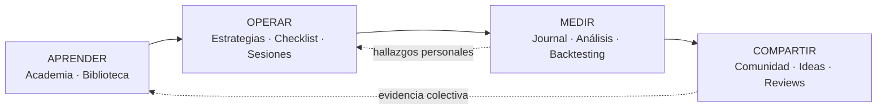
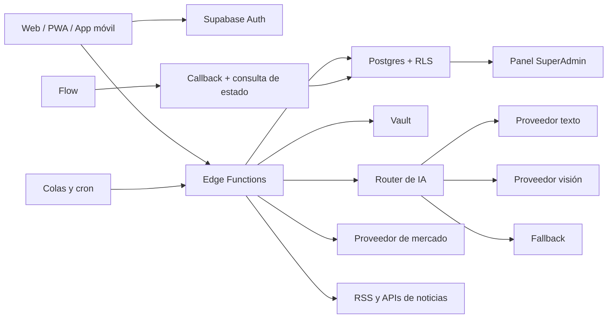
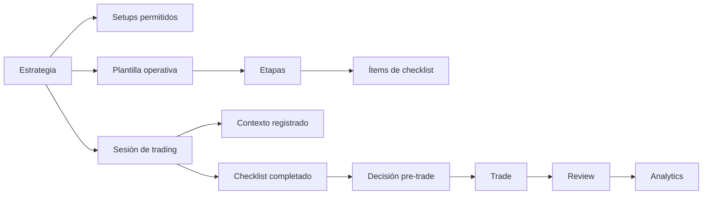
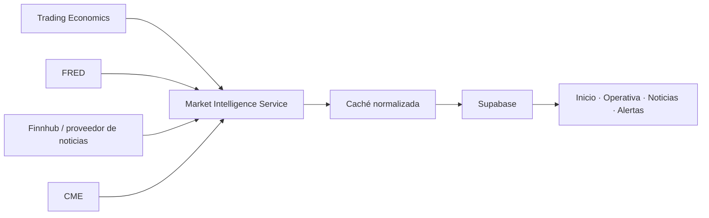

# LineaTrade — Plan maestro de lanzamiento

> Estado de ejecución (15 de septiembre de 2026): seguridad del rol de administrador
> registrada en producción; Academia web y progreso sincronizado desplegados a nivel
> de base de datos; esquema de planes Free/Pro/BYOK y resolución server-side de
> entitlements desplegados. Pendientes para activar cobros: cuenta Flow, plan Pro,
> credenciales API y URLs definitivas de confirmación y retorno.

> Plataforma web, PWA y futura aplicación móvil para journaling, análisis, backtesting e investigación asistida para traders.

**Versión:** 2.0  
**Fecha:** 15 de septiembre de 2026  
**Estado:** ejecución previa al lanzamiento  
**Horizonte recomendado:** 12 a 16 semanas para el núcleo comercial; Academia y Comunidad se liberan progresivamente

---

## 1. Objetivo

Convertir el proyecto actual en una plataforma comercial segura, simple de usar y sostenible en costes, con:

- Dashboard diario útil para un trader, sin saturación visual.
- Journal, backtesting, scanner, coach e insights conectados entre sí.
- Noticias y contexto de mercado con fuentes identificables.
- Cotizaciones con procedencia, retraso y estado de mercado visibles.
- Suscripciones con límites y funcionalidades controladas en el servidor.
- Uso de múltiples proveedores de IA y claves BYOK.
- Notificaciones configurables y medibles.
- Panel administrativo operativo, no solo estadístico.
- Experiencia web instalable como PWA y base preparada para aplicación móvil.

El producto no debe presentarse como asesor financiero ni generar instrucciones de compra o venta. Su función es ayudar al usuario a registrar, revisar y entender su propio proceso.

---

## 2. Estado actual verificado

### 2.1 Infraestructura

- [x] Proyecto Supabase `lineatrade` activo y saludable.
- [x] Migraciones históricas locales y remotas sincronizadas antes del hotfix del 14-08-2026.
- [x] Doce Edge Functions activas con verificación JWT.
- [x] Secretos de proveedores almacenados mediante Supabase Vault.
- [x] PWA configurada con service worker y web push.
- [x] Aplicación React/Vite con rutas privadas y carga diferida.
- [x] Motor de gráficos basado en `lightweight-charts`.
- [x] Pruebas, lint, compilación y auditoría de dependencias disponibles.

### 2.2 Seguridad

- [x] Escalada crítica `trader → superadmin` corregida en producción.
- [x] Permisos de `profiles` restringidos por columna.
- [x] Trigger defensivo para impedir cambios no autorizados de `profiles.role`.
- [x] Prueba local de regresión añadida.
- [x] Token temporal compartido durante la auditoría revocado.
- [x] Registrar formalmente el hotfix en el historial remoto durante el próximo despliegue automatizado.
- [ ] Completar pruebas de aislamiento entre usuarios para todas las relaciones padre/hijo.
- [x] Corregir funciones antiguas `security definer` sin `search_path` explícito.

### 2.3 Producto

- [x] Dashboard simplificado preparado localmente.
- [x] Secciones `Herramientas` e `Insights` separadas del dashboard principal.
- [x] Journal, backtesting, scanner, noticias, coach e insights existentes.
- [x] Panel SuperAdmin con métricas básicas y configuración de IA.
- [x] Primera vertical local de Academia: 27 lecciones, cinco módulos, progreso y desbloqueo secuencial.
- [ ] Suscripciones comerciales (base de datos lista; Flow pendiente).
- [x] Entitlements por plan resueltos desde servidor.
- [ ] Libro mayor detallado de consumo y coste de IA.
- [ ] Enrutamiento de varios proveedores por capacidad.
- [ ] Centro de mercado y noticias unificado.
- [ ] Preferencias avanzadas de notificación.
- [ ] Observabilidad de proveedores, noticias y entregas push.

---

## 3. Principios no negociables

1. **La seguridad se aplica en el servidor.** La interfaz nunca es la única barrera.
2. **El usuario conserva la privacidad de su journal.** El administrador trabaja con agregados, soporte consentido y auditoría.
3. **Toda información de mercado muestra fuente y retraso.** Nunca se presenta un dato retrasado como tiempo real.
4. **La IA cita la evidencia utilizada.** No debe inventar operaciones, precios ni métricas.
5. **Cada función costosa tiene límite.** Incluye IA, scraping, market data, scanner y notificaciones.
6. **BYOK no significa infraestructura ilimitada.** La clave paga el modelo, pero LineaTrade sigue pagando cómputo y base de datos.
7. **Mobile no replica el escritorio.** Prioriza registro rápido, alertas y revisión.
8. **Nada de scraping de interfaces cerradas.** Se usan RSS, APIs autorizadas o acuerdos comerciales.
9. **Los cambios de pago son asíncronos.** El estado consultado y verificado mediante la API de Flow es la fuente de verdad comercial.
10. **El lanzamiento será progresivo.** Primero beta cerrada, luego apertura controlada.

---

## 4. Posicionamiento y arquitectura de producto

### 4.1 Promesa central

> **No ayudamos a ganar más dinero. Ayudamos a cometer menos errores.**

LineaTrade es el sistema operativo del proceso de un trader. Conecta lo que el usuario aprende, planifica, ejecuta, registra, analiza y comparte. No es una academia aislada, un agregador de noticias, una plataforma de señales ni un clon de TradingView.

La pregunta de producto para aceptar una función es:

> ¿Ayuda al trader a ejecutar o revisar mejor su proceso, o solamente añade información?

Si solamente añade información, debe reducirse, contextualizarse o eliminarse.

### 4.2 Usuario inicial

Trader discrecional de futuros de índices estadounidenses, principalmente:

- `NQ` — E-mini Nasdaq-100.
- `MNQ` — Micro E-mini Nasdaq-100.
- `ES` — E-mini S&P 500.
- `MES` — Micro E-mini S&P 500.

Opera alrededor de una sesión y estrategia definidas, necesita preparar el contexto antes de abrir el mercado, registrar con rapidez y revisar errores después. La arquitectura debe admitir otros mercados sin diluir este foco inicial.

### 4.3 Los cuatro pilares



**Journey principal:** Aprende → Planifica → Ejecuta → Registra → Analiza → Mejora → Comparte.

### 4.4 Navegación principal

La navegación autenticada tendrá siete áreas estables:

1. Inicio.
2. Academia.
3. Operativa.
4. Journal.
5. Análisis.
6. Comunidad.
7. Biblioteca.

`Soporte`, `Configuración`, `Administración` y `Cerrar sesión` viven en el menú del usuario. No se incorporan “Convenios” ni enlaces comerciales secundarios en la navegación principal.

En móvil se reduce a:

- Inicio.
- Journal.
- Acción central `+`.
- Comunidad.
- Menú.

La acción `+` permite registrar trade, iniciar sesión, crear análisis o publicar.

### 4.5 Dirección visual decidida

**Dominio:** mesa pre-market, niveles, sesiones, riesgo, checklist, evidencia, replay, revisión y disciplina.  
**Color físico:** terminal de grafito, paneles de pizarra, papel de plan, ámbar de advertencia, verde de cumplimiento, rojo de excepción y azul informativo.  
**Firma:** una línea de preparación que une estrategia, checklist, decisión, trade y review; culmina en el Discipline Score.  
**Se rechaza:** mosaicos uniformes de métricas, gamificación escolar infantil y una terminal saturada de precios.

Paleta:

| Token | Valor | Uso |
|---|---|---|
| Canvas | `#0B0E13` | Fondo principal |
| Workbench | `#11161D` | Superficie primaria |
| Lifted | `#181E27` | Panel elevado o inspector |
| Separator | `#252C37` | Divisiones discretas |
| Primary text | `#F2F4F7` | Valores y títulos |
| Secondary text | `#929CAA` | Ayuda y metadata |
| Linea amber | `#F5A524` | Acción, foco y progreso |
| Success | `#3CCB7F` | Cumplimiento/resultado positivo |
| Danger | `#F25F64` | Riesgo, fallo y pérdida |
| Info | `#5B8DEF` | Información neutral |

La profundidad será por cambios sutiles de superficie y divisores de baja intensidad. Radio pequeño, tipografía compacta y números tabulares. El ámbar no debe ocupar más de aproximadamente el 10 % de una vista.

---

## 5. Arquitectura técnica objetivo



### Responsabilidades

- **Cliente:** presentación, interacción, caché no sensible y feedback inmediato.
- **Edge Functions:** autenticación, autorización, límites, llamadas externas y normalización.
- **Postgres:** propiedad, integridad, RLS, entitlements, auditoría y contadores atómicos.
- **Vault:** claves de plataforma y BYOK cifradas.
- **Flow:** clientes, pagos, facturas y suscripciones recurrentes.
- **Proveedor de mercado:** precios y velas conforme a derechos de exhibición.
- **Fuentes de noticias:** contenido autorizado, snippets y enlaces externos.

---

## 6. Roadmap ejecutivo

| Fase | Prioridad | Resultado | Duración orientativa | Puerta de salida |
|---|---:|---|---:|---|
| 0. Seguridad | P0 | Aislamiento y despliegue seguro | 3–5 días | Pruebas RLS negativas aprobadas |
| 1. Fundación comercial | P0 | Planes, Flow y entitlements | 1–2 semanas | Pago completo en entorno sandbox |
| 2. Costes de IA | P0 | Multi-proveedor, cuotas y ledger | 1 semana | Ninguna llamada sin autorización previa |
| 3. Núcleo operativo | P0 | Estrategias, sesiones y checklist | 2–3 semanas | Flujo pre-trade completo |
| 4. Journal y Discipline Score | P0 | Registro y medición del proceso | 2 semanas | Score explicable y reproducible |
| 5. Centro de mercado | P1 | Dashboard, calendario y contexto | 1–2 semanas | Fuente/retraso visibles en todo dato |
| 6. Noticias | P1 | Ingesta resiliente y briefs citados | 1 semana | Salud y deduplicación verificadas |
| 7. Notificaciones | P1 | Preferencias, cola y métricas | 1 semana | Entregas idempotentes y quiet hours |
| 8. Academia y Biblioteca | P1 | Aprendizaje conectado a práctica | 2 semanas | Lección → evidencia verificable |
| 9. Comunidad | P2 | Feed, espacios y trade reviews | 2–3 semanas | Moderación y privacidad operativas |
| 10. Admin operativo | P1 | Costes, salud, pagos y auditoría | 1 semana | Incidentes detectables desde admin |
| 11. Web/PWA/App | P1 | UX responsive y distribución | 1 semana | Checklist instalable y móvil aprobado |
| 12. Beta y lanzamiento | P0 | Publicación controlada | 1–2 semanas | Go/no-go firmado |

Market Intelligence, Academia y Comunidad pueden avanzar por carriles separados después de completar identidad, entitlements y el modelo operativo compartido.

---

## 7. Fase 0 — Seguridad y preparación de producción

### Objetivo

Cerrar todas las rutas de escalada, referencias cruzadas y configuraciones inseguras antes de aceptar pagos.

### Trabajo

#### SEC-001 — Rol de administrador

- [x] Revocar `UPDATE` completo de `profiles` para `authenticated`.
- [x] Autorizar solamente columnas editables.
- [x] Proteger `role` mediante trigger.
- [x] Añadir prueba estática de regresión.
- [ ] Añadir una prueba real con dos usuarios en base local.
- [ ] Crear RPC exclusiva y auditada si en el futuro se habilita promoción de administradores.

**Criterio de aceptación:** un usuario autenticado recibe `42501` al intentar cambiar su rol y no puede ejecutar RPC administrativas.

#### SEC-002 — Propiedad de relaciones padre/hijo

Revisar y reforzar:

- `trade_orders.trade_id`
- `trade_threads.trade_id`
- `trade_confluences.trade_id`
- `chart_annotations.trade_id`
- `chart_annotations.backtest_session_id`
- `ai_coach_messages.conversation_id`

Cada `INSERT` y `UPDATE` debe comprobar que el padre relacionado pertenece al mismo `auth.uid()`.

**Implementación recomendada:** políticas `WITH CHECK` con `EXISTS`, claves compuestas cuando corresponda y triggers de integridad para evitar futuras rutas alternativas.

**Criterio de aceptación:** el usuario A no puede crear, bloquear ni relacionar registros usando UUID del usuario B.

#### SEC-003 — Funciones privilegiadas

- Inventariar todas las funciones `security definer`.
- Exigir `set search_path = ''` o un esquema mínimo explícito.
- Revocar `EXECUTE` de `public` por defecto.
- Conceder únicamente a `authenticated` o `service_role` según el caso.
- Confirmar que cada función valida identidad internamente.
- Registrar en `audit_log` las operaciones administrativas.

#### SEC-004 — Secretos

- Mantener proveedor y BYOK en Vault.
- Prohibir secretos en `.env.example`, cliente, logs y mensajes de error.
- Añadir `rotated_at`, `last_used_at` y estado activo.
- Documentar rotación de claves comprometidas.
- Configurar alertas por uso anómalo.

#### SEC-005 — Verificación de lanzamiento

- Pruebas RLS para usuario propietario, segundo usuario, administrador y service role.
- Revisión de Storage policies para avatares e imágenes de trades.
- Prueba de recuperación de backup.
- Revisión de CORS y orígenes permitidos.
- Rate limiting de autenticación y funciones costosas.
- Cabeceras CSP, HSTS, Referrer-Policy y Permissions-Policy.

### Entregables

- Migraciones de hardening.
- Matriz de permisos.
- Suite de pruebas RLS.
- Runbook de incidente y rotación de secretos.

---

## 8. Fase 1 — Suscripciones y entitlements

### Objetivo

Cobrar por valor funcional y controlar el acceso desde el servidor.

### Planes iniciales

| Capacidad | Free | Pro | BYOK |
|---|---|---|---|
| Journal y dashboard | Completo | Completo | Completo |
| Backtesting | Básico | Avanzado | Avanzado |
| Noticias | Feed general | Briefs, filtros y watchlist | Igual a Pro |
| IA incluida | 3 acciones/día | Bolsa mensual | Usa clave propia |
| Scanner | Limitado | Completo | Completo |
| Insights históricos | Vista básica | Completo | Completo |
| Alertas | Recordatorio diario | Reglas y watchlist | Reglas y watchlist |
| Coste de modelo | LineaTrade | LineaTrade | Usuario |

Los límites exactos deben poder cambiarse desde configuración sin desplegar frontend.

### Modelo de datos

#### `billing_customers`

- `user_id`
- `provider_customer_id` (`customerId` de Flow)
- `created_at`

#### `subscriptions`

- `user_id`
- `provider_subscription_id` (`subscriptionId` de Flow)
- `provider_product_id` (`planId` de Flow)
- `provider_price_id` (opcional; el precio vive en el plan Flow)
- `status`
- `current_period_start`
- `current_period_end`
- `cancel_at_period_end`
- `trial_end`
- `updated_at`

#### `plan_entitlements`

- `plan_key`
- `feature_key`
- `enabled`
- `hard_limit`
- `period`
- `metadata`

#### `user_entitlement_overrides`

- `user_id`
- `feature_key`
- `enabled`
- `hard_limit`
- `expires_at`
- `reason`
- `created_by`

### Flujo de pago

1. Usuario selecciona plan.
2. Edge Function crea Checkout Session.
3. Flow registra al cliente y crea la suscripción al plan.
4. Flow envía un token al callback; el backend consulta el estado firmado en la API y guarda el resultado idempotentemente.
5. Se actualiza `subscriptions`.
6. El servidor resuelve entitlements antes de cada operación protegida.
7. Customer Portal gestiona tarjeta, factura y cancelación.

### Eventos y estados mínimos de Flow

- registro de cliente confirmado
- suscripción creada o cancelada
- invoice pagado
- invoice vencido o cobro rechazado
- conciliación periódica del estado de la suscripción

### Reglas

- Nunca confiar en `success_url` como confirmación de pago.
- Firmar todas las llamadas con HMAC-SHA256 y consultar el estado usando el token del callback.
- Guardar `event_id` para idempotencia.
- No borrar acceso de inmediato por un fallo transitorio; modelar `past_due` y periodo de gracia.
- El cliente solo muestra el estado; no lo decide.

### Criterios de aceptación

- Compra, renovación, cancelación y fallo de pago probados en modo test.
- Eventos repetidos no duplican suscripciones ni consumo.
- Cambiar de plan modifica entitlements sin tocar el código del cliente.
- Un usuario Free no puede invocar directamente una función Pro.

Referencias: [API de Flow](https://developers.flow.cl/api), [crear suscripción](https://developers.flow.cl/docs/suscripciones/create-suscription) y [flujo de integración](https://developers.flow.cl/docs/suscripciones/integration-flow).

---

## 9. Fase 2 — IA multi-proveedor y control de costes

### Objetivo

Separar capacidades, permitir múltiples claves y conocer el coste real de cada funcionalidad.

### Problemas actuales

- Configuración principal centrada en un solo proveedor/modelo.
- Una ruta común para texto y visión.
- Límite diario compartido entre funcionalidades muy diferentes.
- Frontend con límite Free fijado en `3`, aunque el admin puede cambiarlo.
- Métricas sin dimensión suficiente de proveedor, modelo, tokens y coste.

### Modelo objetivo

#### `ai_provider_accounts`

- `id`
- `owner_type`: `platform` o `user`
- `owner_id`
- `provider`
- `capabilities[]`: texto, visión, embeddings, audio
- `vault_secret_id`
- `priority`
- `monthly_budget_usd`
- `active`
- `rotated_at`
- `last_used_at`

#### `ai_model_routes`

- `feature_key`
- `provider_account_id`
- `model`
- `fallback_priority`
- `max_input_tokens`
- `max_output_tokens`
- `timeout_ms`
- `enabled`

#### `ai_usage_events`

- `request_id`
- `user_id`
- `feature_key`
- `provider`
- `model`
- `source`: plataforma o BYOK
- `input_tokens`
- `output_tokens`
- `estimated_cost_usd`
- `latency_ms`
- `status`
- `error_code`
- `created_at`

### Flujo obligatorio

1. Autenticar usuario.
2. Resolver entitlement de la funcionalidad.
3. Reservar cuota atómicamente.
4. Elegir una ruta compatible con la capacidad solicitada.
5. Ejecutar con timeout.
6. Aplicar fallback solamente ante errores permitidos.
7. Registrar uso, coste, latencia y resultado.
8. Reconciliar reserva con consumo real.

### Políticas de fallback

- No reenviar automáticamente contenido privado a otro proveedor sin informar en privacidad.
- Nunca enviar imagen a un modelo sin capacidad de visión.
- No repetir ante errores de validación o contenido bloqueado.
- Máximo un fallback para evitar multiplicar costes.
- Circuit breaker por proveedor y modelo.

### Cambios de interfaz

- Obtener límites desde servidor, nunca usar `FREE_TIER_DAILY_LIMIT = 3` fijo.
- Mostrar acciones restantes o crédito mensual.
- Indicar cuándo se está usando BYOK.
- Mostrar errores accionables: cuota, clave inválida, proveedor caído o plan insuficiente.

### Criterios de aceptación

- Cada llamada tiene `request_id` único y evento de uso.
- El admin puede separar texto y visión.
- Una clave caída activa fallback sin doble cobro lógico.
- Los presupuestos diarios y mensuales cortan el consumo.
- El usuario nunca puede leer claves ni identificadores Vault.

---

## 10. Fase 3 — Núcleo operativo configurable

### Objetivo

Convertir la preparación pre-trade en un flujo configurable por estrategia. El sistema no decide si comprar o vender; mide si la decisión del usuario cumple sus propias reglas.

### 10.1 Modelo de dominio



### 10.2 Estrategias

Una estrategia debe tener datos estructurados, no un documento de texto libre:

- nombre y descripción
- instrumentos y contratos
- sesión y zona horaria
- hora de inicio y fin
- riesgo máximo diario
- riesgo máximo por trade
- RR mínimo
- máximo de trades
- días permitidos
- restricciones por noticias
- setups permitidos
- estado borrador/activo/archivado
- versión y fecha efectiva

Una modificación material crea una nueva versión. Cada sesión y trade conserva la versión usada, para que las estadísticas históricas no cambien retroactivamente.

### 10.3 Entidades nuevas o evolucionadas

#### `strategy_versions`

- `strategy_id`, `version`, `effective_from`
- límites de riesgo y operación
- horario, días y zona horaria
- política de noticias
- snapshot inmutable de reglas

#### `setup_models`

- nombre, estrategia y versión
- instrumentos y sesión
- RR mínimo
- estado
- descripción operativa

#### `setup_conditions`

- setup
- tipo de condición
- operador y valor esperado
- requerida/opcional
- peso de cumplimiento
- orden de presentación

Ejemplo M3: liquidity sweep, HTF alineado, MSS, FVG, entrada al 50 % y RR mínimo 2.

#### `checklist_templates`

- estrategia y versión
- nombre
- estado activo
- versión

#### `checklist_stages`

- plantilla
- clave: preparación, mensual, semanal, diario, 4H, 1H, decisión, ejecución o registro
- título y orden

#### `checklist_items`

- etapa
- pregunta o condición
- tipo de respuesta
- requerida
- peso
- regla de visibilidad opcional
- evidencia requerida

#### `trading_sessions`

- usuario, estrategia y versión
- instrumento y contrato
- fecha, sesión y zona horaria
- estado: preparando/lista/en curso/cerrada/no-trade
- riesgo y límite de trades usados
- compliance agregado
- motivo de no-trade

#### `checklist_responses`

- sesión, ítem y usuario
- valor normalizado
- nota y evidencia
- timestamp

### 10.4 Contexto de mercado

Crear un snapshot por sesión con:

- `monthly_bias`, `weekly_bias`, `daily_bias`, `h4_bias`, `h1_bias`
- valores `bullish`, `bearish`, `neutral`
- Monthly/Weekly/Daily High y Low
- PDH, PDL, PWH, PWL
- Asia High/Low
- London High/Low
- notas y capturas

Los niveles se almacenan como números y tipo, nunca incrustados únicamente en texto.

### 10.5 Zonas de mercado

Entidad `market_zones`:

- usuario, estrategia, sesión y trade opcional
- tipo: FVG, Order Block, Breaker, 50 % OB, Liquidity, VWAP, Previous High, Previous Low o Custom
- timeframe
- precio superior e inferior
- dirección
- estado: activa, mitigada o invalidada
- fecha de detección y resolución
- captura y notas

Esto permite medir posteriormente rendimiento por zona y combinaciones como `FVG 4H + sweep PDL`.

### 10.6 Checklist y stepper

El flujo usa un stepper compacto y desplazable:

`Prep → Week → Day → 4H → 1H → Trade`

Cada etapa muestra únicamente sus ítems, progreso local, evidencia y acción “Guardar y continuar”. Debe poder guardarse parcialmente, reanudarse y bloquear pasos dependientes cuando una regla así lo indique.

### 10.7 Decisión pre-trade

Al terminar, el usuario selecciona:

- `LONG`
- `SHORT`
- `NO TRADE`

La pantalla presenta **Strategy Compliance**, por ejemplo `8/9 condiciones cumplidas`, con desglose de alineación HTF, liquidez, setup, horario, noticias, RR, riesgo y psicología.

La redacción permitida es: “Esta operación cumple 8 de 9 condiciones de tu estrategia”. La redacción prohibida es “Compra”, “Vende”, “NQ subirá” o equivalentes.

### 10.8 Calendario económico integrado

El calendario no se limita a listar eventos. Cruza cada evento con la política de la estrategia:

- evento, hora e impacto
- actual, forecast, previous y consensus
- instrumentos/mercados relacionados
- ventana prohibida antes/después
- estado de la sesión

Ejemplo: `CPI en 12 minutos · regla 15 min antes/después · estado NO TRADE`.

### Criterios de aceptación

- Dos estrategias pueden definir etapas y reglas distintas sin cambios de código.
- Cada sesión conserva la versión de estrategia aplicada.
- El usuario puede completar el checklist desde móvil.
- El servidor calcula compliance desde respuestas persistidas.
- Las restricciones de noticias se resuelven por zona horaria.
- Ningún texto del sistema constituye una señal automática.

---

## 11. Fase 4 — Journal, análisis y Discipline Score

### Objetivo

Hacer del journal una evidencia estructurada del proceso y convertir disciplina versus resultado en la ventaja principal del producto.

### 11.1 Navegación del Journal

- Calendario.
- Operaciones.
- Sesiones.

La vista calendario muestra resultado diario en R, número de trades y nivel de disciplina. Al abrir un día, se listan trades, setup, resultado, sesión y review.

### 11.2 Registro de operación

#### Ejecución

- instrumento y contrato
- dirección
- fecha y hora de entrada/salida
- setup y estrategia/version
- entry, stop y take profit
- contratos
- riesgo planificado y real
- resultado monetario y en R

#### Contexto

- biases mensual/semanal/diario/4H/1H
- sweep PDH/PDL/PWH/PWL
- FVG, OB, VWAP y otras zonas relacionadas
- eventos económicos cercanos
- sesión y franja horaria

#### Psicología previa

- confianza
- ansiedad
- FOMO
- cansancio
- impulsividad

#### Review posterior

- seguí el plan
- moví el stop
- cerré temprano
- sobreoperé
- revenge trading
- trade impulsivo
- aprendizaje y próxima acción

#### Evidencia visual

- Screenshot Before.
- Screenshot Entry.
- Screenshot Exit.
- Screenshot Review.

### 11.3 Analytics

Métricas base:

- Net P&L
- Win Rate
- Profit Factor
- Expectancy
- Average R
- Max Drawdown
- Equity Curve

Dimensiones:

- setup
- día y hora
- sesión
- instrumento
- estrategia y versión
- contexto y zona
- estado psicológico
- dentro/fuera del plan

Comparación central:

| Segmento | Win Rate | Expectancy | Profit Factor | Trades |
|---|---:|---:|---:|---:|
| Dentro del plan | calculado | calculado | calculado | n |
| Fuera del plan | calculado | calculado | calculado | n |

### 11.4 Discipline Score

El score es determinístico y explicable, de `0` a `100`. La IA puede interpretarlo, pero no calcularlo.

#### Componentes iniciales

| Componente | Peso inicial | Evidencia |
|---|---:|---|
| Checklist | 20 % | Ítems requeridos cumplidos |
| Riesgo | 20 % | Riesgo por trade y diario respetado |
| Horario | 10 % | Dentro de ventana autorizada |
| Noticias | 10 % | Fuera de ventana prohibida |
| Setup permitido | 10 % | Setup incluido en la versión |
| Máximo de trades | 10 % | Límite diario respetado |
| Gestión | 10 % | Stop y salida según plan |
| Psicología | 10 % | Sin impulsividad/revenge/overtrading |

#### Fórmula

```text
score = Σ (component_score × component_weight)
```

Cada `component_score` vale entre `0` y `1`. Si no existe evidencia suficiente, el componente se marca `sin datos`; no se asume cumplimiento. La política inicial debe decidir si se renormaliza o se muestra score provisional. Recomendación: no renormalizar elementos requeridos y distinguir `provisional` de `final`.

#### Niveles

- `90–100`: proceso consistente.
- `75–89`: proceso estable con desviaciones.
- `60–74`: disciplina frágil.
- `<60`: fuera del plan con frecuencia.

Los niveles no otorgan premios ni rachas de estilo infantil. Sirven para priorizar revisión.

#### Persistencia

Guardar por trade y sesión:

- score total
- versión de fórmula
- componentes y evidencias
- datos faltantes
- fecha de cálculo

Una nueva fórmula no reescribe el pasado; puede recalcularse como una nueva versión para comparación explícita.

### 11.5 Insights conductuales

La IA recibe agregados y evidencia, por ejemplo:

- resultado por horario
- resultado respetando/moviendo stop
- trades dentro/fuera del plan
- frecuencia de revenge trading
- combinaciones de contexto y setup

El insight debe incluir muestra, periodo, métrica y limitación. Ejemplo: “En 38 operaciones, tu expectancy después de las 11:00 fue menor. Revisa si esa franja sigue perteneciendo a tu estrategia”.

### Criterios de aceptación

- El mismo conjunto de datos produce siempre el mismo Discipline Score.
- El usuario puede ver por qué perdió puntos.
- Toda estadística declara tamaño de muestra.
- Trades históricos permanecen vinculados a estrategia, setup y fórmula versionados.
- La IA no modifica métricas ni presenta correlación como causalidad.

---

## 12. Fase 5 — Dashboard y centro de mercado

### Objetivo

Crear una pantalla diaria sencilla que responda rápidamente:

1. ¿Qué tengo que hacer hoy?
2. ¿Puedo operar según mi estrategia?
3. ¿Cómo va mi proceso?
4. ¿Qué estoy aprendiendo?
5. ¿Hay eventos importantes?

### Jerarquía de Inicio

El foco no es una cotización ni el P&L: es **Sesión de hoy**.

```text
Buenos días, Jonathan                       NQ / MNQ · New York AM

SESIÓN DE HOY
Checklist 6/8 · Plan listo · Riesgo máx. $40 · Trades 1/2
[Continuar preparación]

Win Rate · Profit Factor · Expectancy · Resultado R · Discipline Score

Continuar aprendiendo

Actividad relevante de la comunidad
```

Si hay un evento bloqueante, el estado de preparación debe explicarlo antes del CTA. Si no existe estrategia activa, el foco cambia a “Configurar mi estrategia”. Si el mercado está cerrado, se prioriza revisión o aprendizaje.

### Arquitectura visual de escritorio

```text
┌────────────────┬──────────────────────────────────┬────────────────────┐
│ Watchlist      │ Mercado hoy                      │ Investigación      │
│ Trades abiertos│ Regiones / activos / cotizaciones│ Preguntas con IA   │
│ Calendario     │ Resumen citado                   │ Fuentes y consumo  │
│ Alertas        │ Noticias por ticker              │ Contexto del journal│
└────────────────┴──────────────────────────────────┴────────────────────┘
```

### Arquitectura móvil

1. Búsqueda de símbolo.
2. Watchlist horizontal.
3. Resumen de mercado.
4. Operaciones que requieren revisión.
5. Noticias priorizadas.
6. Investigación como panel inferior o pestaña.

### Componentes

- Buscador persistente de símbolos.
- Franja compacta de índices, divisas, commodities y cripto.
- Tabs por región y clase de activo.
- Estado `abierto`, `cerrado`, `pre-market` o `after-hours`.
- Etiqueta `tiempo real`, `15 min retrasado` o `fin de día`.
- Mini gráficos sin interacción pesada.
- Watchlist con variación, alerta y operación relacionada.
- Resumen de mercado con fuentes visibles.
- Noticias con ticker, región, hora y nivel de relevancia.
- CTA contextual: registrar trade, revisar trade o preguntar a LineaTrade.

### Dirección visual

- Fondo oscuro sobrio.
- Acento ámbar reservado para acción y estado importante.
- Verde/rojo solo para semántica financiera.
- Filas, separadores y tablas antes que exceso de tarjetas.
- Densidad informativa inspirada en plataformas profesionales, sin copiar su identidad.
- Movimiento sutil para cambios de precio, expansión y estados.

### Datos de mercado

- Mantener `lightweight-charts` para gráficos propios.
- Usar una API con derechos comerciales de exhibición.
- Evaluar Twelve Data Business/Venture u otro proveedor equivalente.
- Cachear snapshots según la licencia y el tipo de dato.
- Desacoplar proveedor mediante una interfaz `MarketDataProvider`.

**Criterio de aceptación:** ningún precio aparece sin fuente, timestamp y política de retraso.

### Market Intelligence Service

Crear una capa backend única para evitar que cada pantalla integre proveedores directamente:



Responsabilidades:

- adaptadores por proveedor
- símbolos canónicos (`NQ`, `MNQ`, `ES`, `MES`)
- normalización de timestamps y zona horaria
- calendario económico
- datos macro de Estados Unidos
- noticias y entidades relacionadas
- contratos, vencimientos y rollover
- cache, rate limits, backoff y observabilidad
- procedencia y política de retraso por campo

Fuentes objetivo:

- Trading Economics: calendario, actual, forecast, previous, consensus e importancia.
- FRED: Fed Funds, CPI, desempleo, yields y series macro oficiales.
- Finnhub/Benzinga o proveedor licenciado: headlines, empresas Nasdaq y earnings.
- CME: especificaciones, símbolos, contratos, vencimientos y rollover.

El market data real-time se mantiene fuera del MVP hasta contratar derechos de exhibición adecuados.

Referencias: [TradingView Datafeed API](https://www.tradingview.com/charting-library-docs/latest/connecting_data/datafeed-api/), [GoCharting Features](https://gocharting.com/features), [Twelve Data uso comercial](https://support.twelvedata.com/en/articles/5332349-commercial-and-personal-usage).

---

## 13. Fase 6 — Noticias e investigación

### Objetivo

Transformar el feed existente en contexto relevante para las operaciones del usuario.

### Política de fuentes

- No hacer scraping de Google Finance.
- No hacer scraping de la interfaz de Yahoo Finance.
- Mantener Yahoo únicamente como RSS/snippet y enlace externo.
- Tratar `fair use` como una decisión de producto, no como una licencia automática.
- Verificar `robots.txt` dinámicamente antes de cualquier extracción permitida.
- Guardar texto plano mínimo, nunca clonar artículos completos.
- Mostrar atribución y CTA al sitio original.

### Fuentes recomendadas

- RSS de medios autorizados.
- Alpha Vantage News & Sentiment para noticias etiquetadas.
- GDELT para amplitud y detección de eventos.
- CryptoCompare/CoinGecko para cripto según condiciones vigentes.
- Proveedor comercial para cotizaciones y calendarios.

### Taxonomía de relevancia

La noticia se clasifica por:

- relevancia para el usuario
- mercado e instrumento
- impacto bajo/medio/alto
- tema macro o empresa
- ventana temporal

Prioridades iniciales: Federal Reserve, CPI, PPI, NFP, GDP, Powell, Treasury, NVDA, MSFT, AAPL, AMZN, META, GOOGL, TSLA, semiconductores e inteligencia artificial.

Una noticia enriquecida muestra: impacto, mercados relacionados, resumen, qué observar y fuentes. “Qué observar” presenta variables o eventos, nunca una predicción direccional.

### Modelo de datos

#### `news_sources`

- nombre, tipo, URL y dominio
- estado habilitado
- licencia/política de uso
- límite por minuto
- `robots_checked_at`
- `etag` y `last_modified`
- fallos consecutivos
- `backoff_until`
- última ejecución exitosa

#### `news_ingest_runs`

- fuente
- inicio y fin
- artículos recibidos, insertados y duplicados
- código HTTP
- error normalizado
- duración

#### Enriquecimiento de artículos

- URL canónica
- hash de título
- idioma y región
- tickers y entidades
- clase de activo
- categoría
- relevancia
- sentimiento del proveedor, claramente etiquetado
- timestamp original y timestamp de ingesta

### Pipeline

1. Seleccionar fuentes habilitadas fuera de backoff.
2. Descargar con timeout y concurrencia máxima de 3.
3. Utilizar `If-None-Match` y `If-Modified-Since`.
4. Normalizar y deduplicar.
5. Enriquecer por ticker, región y categoría.
6. Relacionar con watchlists y trades abiertos.
7. Generar briefs desde artículos almacenados.
8. Guardar IDs de fuentes utilizadas por la IA.

### Brief de mercado

Cada resumen debe incluir:

- alcance temporal
- región o clase de activo
- hechos principales
- activos relacionados
- posibles escenarios como contexto, no recomendación
- enlaces a las fuentes
- advertencia cuando la evidencia sea insuficiente

### Resiliencia

- Backoff exponencial con jitter.
- Circuit breaker por fuente.
- Máximo de reintentos.
- Cola de reingesta.
- Panel de salud y alerta por feed estancado.

### Criterios de aceptación

- Menos de 3 % de duplicados visibles.
- Toda historia muestra fuente y hora.
- Ningún brief se publica sin IDs de evidencia.
- Una fuente caída no bloquea las demás.
- Yahoo y fuentes restringidas permanecen en modo snippet-only.

Referencias: [Yahoo Terms](https://legal.yahoo.com/xw/en/yahoo/terms/otos/index.html), [Alpha Vantage News API](https://www.alphavantage.co/documentation/).

---

## 14. Fase 7 — Notificaciones inteligentes

### Objetivo

Pasar de un recordatorio genérico a notificaciones útiles, consentidas y controladas.

### UX de permiso

- Eliminar la solicitud nativa automática al iniciar sesión.
- Mostrar una pantalla previa que explique el beneficio.
- Solicitar permiso únicamente después de una acción del usuario.
- Ofrecer reintento guiado si el permiso fue bloqueado.
- Mostrar estado del dispositivo en Configuración.

### `notification_preferences`

- zona horaria
- hora de recordatorio
- días activos
- horas silenciosas
- recordatorio de journal
- seguimiento de trade abierto
- alertas de watchlist
- brief diario/semanal
- avisos de cuenta y pagos
- canal push/email futuro

### Cola de entrega

#### `notification_events`

- tipo
- usuario
- payload normalizado
- clave de idempotencia
- prioridad
- fecha programada

#### `notification_deliveries`

- evento
- suscripción/dispositivo
- intento
- estado
- respuesta del proveedor
- siguiente reintento
- enviado, abierto y descartado

### Reglas inteligentes iniciales

- No registró ninguna operación hoy, dentro de su horario elegido.
- Trade abierto sin actualización durante un periodo configurable.
- Movimiento porcentual definido por el usuario en un activo seguido.
- Nuevo evento económico relevante para una watchlist.
- Revisión semanal de disciplina y métricas.
- Pago fallido o cambio de suscripción.

### Requisitos técnicos

- Usar `profiles.timezone`.
- Respetar quiet hours y días configurados.
- Procesar en lotes con límite de concurrencia.
- Eliminar endpoints 404/410.
- Retry controlado para fallos temporales.
- Incluir deep link y `collapse/topic`.
- No emitir señales de trading automáticas.

### Criterios de aceptación

- No aparece el prompt nativo sin gesto del usuario.
- Un evento no genera entregas duplicadas.
- Las notificaciones respetan zona horaria.
- El admin puede medir enviado, entregado, abierto y fallido.

---

## 15. Fase 8 — Academia y Biblioteca

### Objetivo

Conectar aprendizaje con práctica verificable. Academia enseña una secuencia; Biblioteca permite consultar recursos independientes.

### 15.1 Academia

#### Estructura

```text
Programa → Módulo → Lección → Actividad práctica → Evidencia → Progreso
```

Entidades:

- `academy_programs`
- `academy_modules`
- `academy_lessons`
- `lesson_resources`
- `practice_requirements`
- `user_lesson_progress`
- `practice_evidence`

Cada módulo define orden, prerrequisitos y criterios de desbloqueo. El estado puede ser bloqueado, disponible, en progreso o completado.

#### Flujo pedagógico

`Aprender → Simular → Backtesting → Registrar ejemplos → Completar`

Una lección como “Liquidity Sweep” puede exigir:

1. Consumir la lección.
2. Abrir el simulador.
3. Completar una cantidad de repeticiones.
4. Registrar ejemplos válidos e inválidos.
5. Escribir una conclusión.

No se completa únicamente por reproducir un video.

#### Pantalla principal

- progreso general y lecciones completadas
- continuar desde la última actividad
- módulos y prerequisitos
- práctica pendiente
- conexión con resultados reales del journal cuando sea apropiado

### 15.2 Biblioteca

Es independiente de Academia y admite:

- PDF
- video
- plantilla
- checklist
- indicador
- guía
- trading plan

Funciones:

- búsqueda
- filtros por tipo, instrumento, nivel, setup y autor
- guardados
- historial reciente
- descarga o enlace según licencia
- relación opcional con lecciones, estrategias y espacios

### 15.3 Administración de contenido

- borrador, revisión, publicado y archivado
- versión y autor
- duración y nivel
- fecha de actualización
- assets protegidos
- métricas de inicio, finalización y práctica

### Criterios de aceptación

- Los desbloqueos se calculan en el servidor.
- El progreso no depende solo de tiempo reproducido.
- Una práctica puede verificarse con sesiones de backtesting o ejemplos registrados.
- Biblioteca y Academia comparten recursos sin compartir su navegación.
- El contenido respeta permisos de plan y licencia.

---

## 16. Fase 9 — Comunidad y espacios

### Objetivo

Crear una comunidad editorial útil para aprender y revisar procesos, evitando convertirla en un feed de señales o resultados ostentosos.

### 16.1 Feed

Filtros principales:

- Destacado.
- Tendencias.
- Más recientes.
- Siguiendo.
- Espacios.

Tipos de contenido:

- artículo
- idea
- análisis
- setup
- pregunta
- trade review

Cada publicación puede contener texto, imágenes, gráficos, tags, instrumento, setup, timeframe, autor, reacciones, comentarios y guardados.

### 16.2 Espacios iniciales

- NQ / MNQ
- ES / MES
- Price Action
- ICT
- Order Flow
- Psicología
- Risk Management
- Backtesting
- Principiantes

El usuario sigue espacios y autores; esas señales afectan el feed. Las recomendaciones deben priorizar relevancia temática, calidad y afinidad, no únicamente engagement.

### 16.3 Modelo de datos

- `community_spaces`
- `space_memberships`
- `creator_follows`
- `community_posts`
- `post_assets`
- `post_tags`
- `post_reactions`
- `post_comments`
- `post_saves`
- `content_reports`
- `moderation_actions`

### 16.4 Privacidad y publicación de trades

- Un trade privado nunca se vuelve público por defecto.
- “Publicar trade review” crea un snapshot redactado, no expone la fila privada.
- El usuario revisa qué campos e imágenes se comparten.
- Se eliminan account IDs, broker IDs, notas privadas y metadatos sensibles.
- Borrar la publicación no debe borrar el trade; borrar el trade debe definir qué ocurre con el snapshot publicado.

### 16.5 Calidad y moderación

- reglas contra señales, spam, promesas de rentabilidad y suplantación
- reportes de usuarios
- rate limits de publicación/comentario/reacción
- estados publicado, limitado, oculto y eliminado
- auditoría de acciones de moderación
- bloqueo y silencio de usuarios
- filtros de contenido y enlaces maliciosos

### 16.6 Tendencias

Puntaje con ventana temporal, diversidad de autores y penalización por actividad coordinada. No debe favorecer capturas de P&L frente a contenido educativo o reviews honestos.

### Criterios de aceptación

- Ningún dato privado se publica sin confirmación explícita.
- Existe reporte, bloqueo y moderación antes de abrir públicamente.
- El feed funciona con estados vacíos y pocos creadores.
- Tags, espacios y seguimiento cambian el contenido mostrado.
- Las políticas prohíben señales directas y marketing engañoso.

---

## 17. Fase 10 — Panel SuperAdmin operativo

### Objetivo

Permitir administrar el negocio, costes y salud sin acceder a contenido privado innecesario.

### Secciones

#### Resumen

- usuarios activos
- conversión Free → Pro
- suscripciones activas, trial, past due y canceladas
- uso y coste de IA
- volumen de noticias
- tasa de entrega push

#### IA

- proveedor por capacidad
- modelo y fallback
- presupuesto diario/mensual
- coste por funcionalidad
- latencia y errores
- última rotación de clave
- prueba de salud sin mostrar el secreto

#### Noticias

- última ejecución por fuente
- artículos nuevos y duplicados
- fallos consecutivos
- estado de robots/licencia
- fuentes deshabilitadas o en backoff

#### Notificaciones

- eventos generados
- entregas exitosas/fallidas
- endpoints inválidos
- reintentos y cola pendiente

#### Suscripciones

- estado sincronizado con Flow
- eventos webhook fallidos
- overrides activos
- historial de cambios administrativos

#### Auditoría

- actor
- acción
- recurso
- timestamp
- motivo
- resultado
- filtros y exportación limitada

### Seguridad del admin

- Ruta protegida en cliente y servidor.
- RPC específicas con `is_superadmin()`.
- Nada de consultas directas a journals ajenos.
- Operaciones destructivas con confirmación y auditoría.
- Sin visualización de secretos.

---

## 18. Fase 11 — Web, PWA y aplicación móvil

### Web

- Responsive desde 360 px.
- Carga diferida por módulo.
- Presupuesto de bundle y Core Web Vitals.
- Estados vacíos, carga y error consistentes.
- Accesibilidad WCAG AA en flujos principales.
- SEO solo para páginas públicas; producto privado no indexable.

### PWA

- Manifest completo e iconos verificables.
- Instalación guiada.
- Pantalla offline segura.
- No cachear datos privados indefinidamente.
- Actualización del service worker sin dejar versiones incompatibles.
- Push probado en Chrome, Edge y Android.
- Documentar limitaciones de iOS.

### Aplicación móvil

#### Estrategia recomendada

Primero validar el producto como PWA. Después empaquetar o desarrollar app nativa según métricas reales.

**Opción inicial:** Capacitor para reutilizar la aplicación web y publicar más rápido.  
**Opción posterior:** React Native/Expo si se requieren widgets, procesos en segundo plano o UX claramente nativa.

#### Alcance móvil v1

- autenticación
- dashboard resumido
- nuevo trade rápido
- foto y extracción asistida
- trades abiertos
- notificaciones
- watchlist y noticias
- coach

El backtesting avanzado puede abrir una vista web optimizada o permanecer inicialmente en escritorio.

### Criterios de aceptación

- Los cinco flujos principales funcionan con una mano en móvil.
- No existen controles críticos fuera del viewport.
- El usuario puede instalar la PWA y recibir notificaciones después de consentir.
- La sesión y los datos privados se eliminan correctamente al cerrar cuenta.

---

## 19. Fase 12 — Calidad, beta y lanzamiento

### Pirámide de pruebas

#### Unitarias

- cálculos de PnL y R
- límites y entitlements
- normalización de noticias
- deduplicación
- enrutamiento y fallback de IA
- reglas de notificación

#### Integración

- RLS con dos usuarios
- callback Flow, consulta firmada e idempotencia
- reserva/reconciliación de consumo
- ingesta de fuentes con 200, 304, 429 y 500
- push con endpoints válidos y expirados

#### End-to-end

- registro y onboarding
- crear, actualizar y cerrar trade
- backtesting y guardado
- compra/cambio/cancelación de plan
- BYOK
- investigación con fuentes
- configuración de notificaciones
- eliminación de cuenta

### Observabilidad

- errores del frontend
- errores y latencia de Edge Functions
- queries lentas
- tasa de error por proveedor
- gasto de IA diario
- salud de cron
- retraso de ingesta
- cola de notificaciones
- fallos de webhook

### Beta cerrada

- 20–50 traders.
- Dos semanas de uso real.
- Entrevistas semanales.
- Seguimiento de activación y retención.
- Presupuesto máximo diario de IA.
- Canal claro para incidentes y feedback.

### Go/no-go

El lanzamiento público requiere:

- [ ] Cero vulnerabilidades P0/P1 abiertas.
- [ ] RLS negativa aprobada.
- [ ] Backup y restauración probados.
- [ ] Pagos y webhooks probados.
- [ ] Coste máximo por usuario modelado.
- [ ] Límites de IA activos.
- [ ] Derechos comerciales de market data confirmados.
- [ ] Política de noticias documentada.
- [ ] Privacidad, términos y disclaimer revisados.
- [ ] Notificaciones con consentimiento.
- [ ] Monitoreo y alertas activas.
- [ ] Soporte y procedimiento de incidente definidos.

---

## 20. Métricas del producto

### Activación

- onboarding completado
- primer trade registrado
- primera revisión cerrada
- primera sesión de backtesting
- primera acción de IA útil

### Retención

- WAU/MAU
- usuarios que registran al menos un trade por semana
- usuarios que vuelven a revisar trades cerrados
- semanas consecutivas con journal

### Monetización

- conversión Free → Pro
- trial → pago
- MRR
- churn voluntario e involuntario
- ingreso medio por usuario
- margen después del coste de IA y market data

### Calidad

- errores por sesión
- p95 de Edge Functions
- tasa de fallback de IA
- noticias duplicadas
- feeds atrasados
- entrega y apertura de push

### Resultado para el trader

- porcentaje de trades con plan previo
- porcentaje con revisión posterior
- adherencia a reglas propias
- reducción de errores repetidos
- evolución de métricas por estrategia

Estas métricas describen proceso y disciplina; no deben prometer rentabilidad.

---

## 21. Backlog priorizado

### P0 — Antes de pagos

- [ ] Completar SEC-002 a SEC-005.
- [ ] Registrar el hotfix de roles mediante despliegue automatizado.
- [ ] Implementar callbacks Flow y conciliación de suscripciones.
- [ ] Implementar entitlements server-side.
- [ ] Crear ledger de IA.
- [ ] Eliminar límites hardcodeados del frontend.
- [ ] Añadir presupuesto global de emergencia.
- [ ] Versionar estrategias y fórmulas de disciplina.
- [ ] Implementar estrategias, setups, plantillas y sesiones.
- [ ] Implementar checklist configurable y Strategy Compliance.
- [ ] Implementar Discipline Score determinístico.
- [ ] Completar la comparación dentro/fuera del plan.

### P1 — Antes de beta pública

- [ ] Nuevo centro de mercado.
- [ ] Proveedor comercial de datos.
- [ ] Pipeline de noticias resiliente.
- [ ] Briefs citados.
- [ ] Preferencias y cola de notificaciones.
- [ ] Admin operativo.
- [ ] Instrumentación de producto y errores.
- [ ] Market Intelligence Service y calendario económico integrado.
- [ ] Academia con práctica verificable.
- [ ] Biblioteca buscable y con permisos.

### P2 — Después de validar retención

- [ ] Aplicación móvil empaquetada.
- [ ] Calendario económico avanzado.
- [ ] Workspaces/layouts guardados.
- [ ] Alertas técnicas más complejas.
- [ ] Integraciones con brokers.
- [ ] Comunidad y espacios después de validar moderación y demanda real.

### Fuera de alcance inicial

- Ejecución automática de órdenes.
- Copy trading.
- Señales de compra/venta generadas por IA.
- Scraping de Google Finance o Yahoo Finance.
- Order flow institucional sin licencia de datos.
- Red social pública de traders.

---

## 22. Dependencias y decisiones pendientes

| Decisión | Recomendación inicial | Momento límite |
|---|---|---|
| Proveedor de pagos | Flow | Antes de Fase 1 |
| Precio de Pro | Definir después de modelar costes | Antes de beta pagada |
| Proveedor de mercado | Plan comercial con display rights | Antes de Fase 5 |
| Proveedores IA | OpenAI + Groq con rutas separadas | Durante Fase 2 |
| Noticias premium | Alpha Vantage como piloto | Durante Fase 6 |
| Error monitoring | Sentry o equivalente | Antes de beta |
| Analytics | PostHog o eventos propios | Antes de beta |
| App móvil | PWA primero, Capacitor después | Después de retención inicial |
| Email transaccional | Seleccionar proveedor | Antes de pagos reales |

---

## 23. Orden de ejecución recomendado

1. Fusionar y desplegar cambios locales pendientes del dashboard con revisión.
2. Ejecutar suite RLS completa y hardening de relaciones.
3. Preparar Flow en entorno sandbox.
4. Implementar entitlements y usage ledger.
5. Refactorizar router multi-proveedor de IA.
6. Implementar modelo de estrategia versionada y setups.
7. Construir sesiones, checklist y decisión pre-trade.
8. Completar registro estructurado y Discipline Score.
9. Contratar/probar proveedor de market data comercial.
10. Construir Market Intelligence y centro de mercado responsive.
11. Rehacer pipeline y observabilidad de noticias.
12. Implementar preferencias y cola de notificaciones.
13. Crear Academia práctica y Biblioteca.
14. Ampliar panel SuperAdmin.
15. Instrumentar métricas y errores.
16. Ejecutar beta cerrada del núcleo Aprende–Opera–Mide.
17. Corregir hallazgos y realizar go/no-go.
18. Lanzar web/PWA.
19. Abrir Comunidad después de validar moderación.
20. Evaluar aplicación móvil con datos reales de uso.

---

## 24. Definición de terminado

Una tarea está terminada únicamente cuando:

- El código está implementado y revisado.
- Incluye migración reversible o procedimiento de recuperación.
- Tiene pruebas proporcionales al riesgo.
- No expone secretos ni datos de otro usuario.
- Tiene estados de carga, vacío y error.
- Está instrumentada si afecta costes o disponibilidad.
- La documentación fue actualizada.
- Compilación, lint y tests pasan.
- Se verificó en staging o entorno equivalente.
- Existe criterio de rollback para producción.

---

## 25. Documentos relacionados

- [`trade-journal-os-prd-v2.md`](./trade-journal-os-prd-v2.md)
- [`trade-journal-os-schema.md`](./trade-journal-os-schema.md)
- [`trade-journal-os-context-engine.md`](./trade-journal-os-context-engine.md)
- [`lineatrade-backtesting-plan.md`](./lineatrade-backtesting-plan.md)
- [`lineatrade-design-system.md`](./lineatrade-design-system.md)
- [`lineatrade-plan-implementacion.md`](./lineatrade-plan-implementacion.md)

Este plan maestro no reemplaza los documentos especializados. Define el orden, las puertas de calidad y el alcance comercial para convertirlos en un lanzamiento coordinado.
